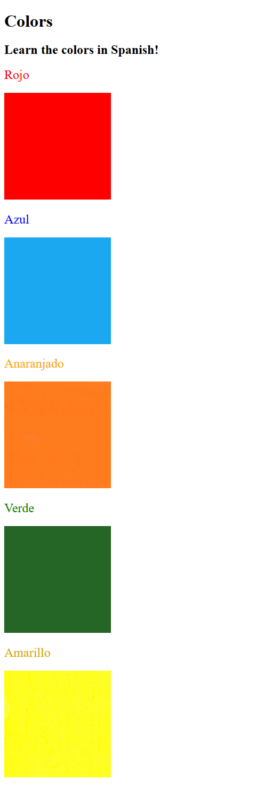

# 🚀 043 Web Colour Vocab

A small flashcard website that teaches the colours in Spanish. Each card shows
the Spanish word, coloured to match its meaning, above a swatch of that colour.
Built with plain HTML and CSS for Udemy's *100 Days of Code*, lesson 5.4
(Color Vocab Project), day 43.



## 📚 Table of Contents

- [Overview](#-overview)
- [Requirements](#-requirements)
- [Setup](#-setup)
- [Run](#-run)
- [Tests](#-tests)
- [License](#-license)
- [Links](#-links)
- [Appendix: Project documents](#-appendix-project-documents)

## 🧭 Overview

The page shows five cards, one per colour:

| Spanish | English | Dansk | Bahasa Malaysia |
| --- | --- | --- | --- |
| Rojo | red | rød | merah |
| Azul | blue | blå | biru |
| Anaranjado | orange | orange | oren |
| Verde | green | grøn | hijau |
| Amarillo | yellow | gul | kuning |

The exercise rule is that `src/index.html` is given and stays unchanged; all
styling is in `src/style.css`. *Amarillo* uses `#d4a900`, because plain
`yellow` is hard to read on a white page.

| Path | Purpose |
| --- | --- |
| `src/index.html` | The page. Given by the exercise and left unchanged. |
| `src/style.css` | All styling: 200px × 200px images, normal-weight titles, one text colour per colour word. |
| `src/assets/images/` | The five colour swatches. |
| `tests/manual-checklist.md` | The checks of the page, run by hand in a browser |

## 📋 Requirements

A web browser. There is no build step, no package to install and no server.

## 🛠️ Setup

Clone the repository:

```bash
git clone https://git.tirsystem.com/Tirsvad-Udemy-100-days-of-code/043-web-colour-vocab.git
cd 043-web-colour-vocab
```

## ▶️ Run

No build step. Open `src/index.html` in a browser.

## 🧪 Tests

The tests are a manual checklist, because the whole product is one static page. Open `src/index.html`, then go through the items of [`tests/manual-checklist.md`](./tests/manual-checklist.md) (the heading, the five colour cards, the stylesheet colours, the picture size, a narrow window and the page title).

## 📄 License

[GNU Affero General Public License v3.0 (AGPL-3.0)][license].

## 🔗 Links

- [Repository][repository]
- [Documentation][documentation]
- [Issue tracker][issues]

More in the wiki, in three languages:
[English](https://git.tirsystem.com/Tirsvad-Udemy-100-days-of-code/043-web-colour-vocab/wiki/Home) ·
[Dansk](https://git.tirsystem.com/Tirsvad-Udemy-100-days-of-code/043-web-colour-vocab/wiki/Home-da) ·
[Bahasa Melayu](https://git.tirsystem.com/Tirsvad-Udemy-100-days-of-code/043-web-colour-vocab/wiki/Home-ms).

## 📎 Appendix: Project documents

The documents a newcomer needs, in reading order.

| Document | What it tells you |
| --- | --- |
| [Business Case][BC-001] | Why the project exists, its scope and success criteria |
| [Stakeholder Analysis][SA-001] | Who is involved; the stakeholder IDs used for owners and reviewers |
| [Project Plan][PP-001] | The gateways and their schedule |
| [Milestones][milestones] | One document per gateway: Go/No-Go criteria and tasks |
| [Artifact registry][registry] | Where each artifact type lives, the next version, the PO language and domain |
| [Traceability matrix][TM-001] | How the artifacts link and when each was last reviewed |

---

[repository]: https://git.tirsystem.com/Tirsvad-Udemy-100-days-of-code/043-web-colour-vocab
[documentation]: https://git.tirsystem.com/Tirsvad-Udemy-100-days-of-code/043-web-colour-vocab/wiki
[issues]: https://git.tirsystem.com/Tirsvad-Udemy-100-days-of-code/043-web-colour-vocab/issues
[license]: ./LICENSE
[BC-001]: ./docs/business-case.md
[SA-001]: ./docs/stakeholder-analysis.md
[PP-001]: ./docs/project-plan.md
[milestones]: ./docs/milestones/
[registry]: ./docs/artifact-registry.md
[TM-001]: ./docs/sqa/traceability-matrix.md
