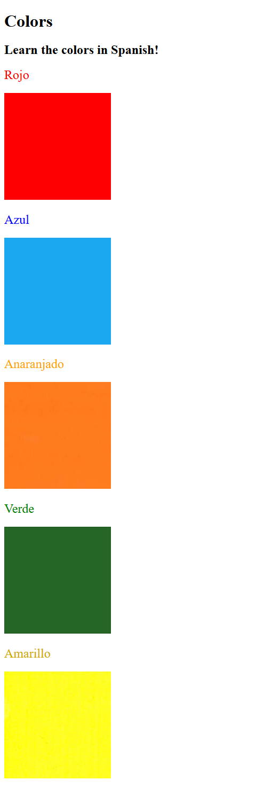

# 043-web-colour-vocab

A small flashcard website that teaches the colours in Spanish. Each card shows
the Spanish word, coloured to match its meaning, above a swatch of that colour.
Built with plain HTML and CSS for Udemy's *100 Days of Code*, lesson 5.4
(Color Vocab Project).

## Vocabulary

| Spanish | English | Dansk | Bahasa Malaysia |
| --- | --- | --- | --- |
| Rojo | red | rød | merah |
| Azul | blue | blå | biru |
| Anaranjado | orange | orange | oren |
| Verde | green | grøn | hijau |
| Amarillo | yellow | gul | kuning |

## Run it

No build step and no dependencies. Open `src/index.html` in a browser.

## Files

| Path | Purpose |
| --- | --- |
| `src/index.html` | The page. Given by the exercise and left unchanged. |
| `src/style.css` | All styling: 200px × 200px images, normal-weight titles, one text colour per colour word. |
| `src/assets/images/` | The five colour swatches. |

## Wiki

Documentation in three languages lives in [`docs/wiki/`](docs/wiki/):

- [English](docs/wiki/Home.md)
- [Dansk](docs/wiki/Home-da.md)
- [Bahasa Malaysia](docs/wiki/Home-ms.md)

## Licence

See [LICENSE](LICENSE).
